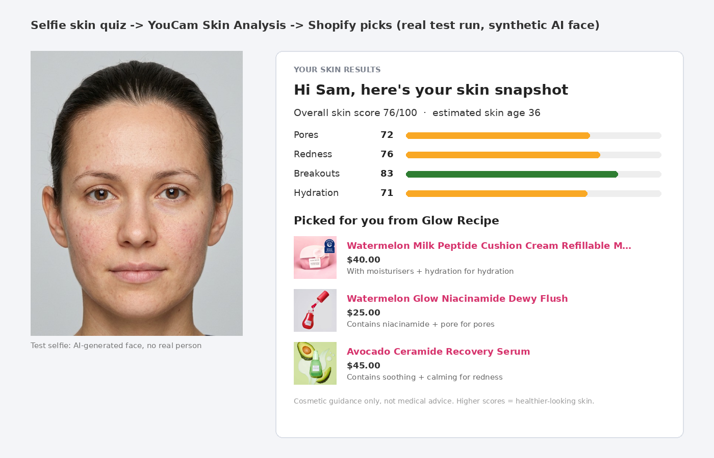
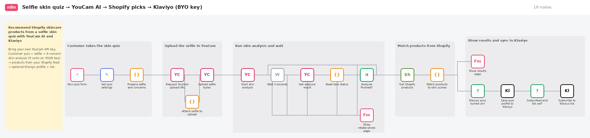

# YouCam skin quiz: selfie → AI skin analysis → Shopify product picks

A dependency-free Node script (and an n8n workflow) that adds an AI **skin analysis quiz** to any Shopify skincare store:

1. Upload a selfie to the [YouCam API](https://yce.makeupar.com/api-console) (Perfect Corp) File API
2. Run **Skin Analysis v2.1** on up to 4 concerns (the cheapest tier: 9 units per analysis at the time of writing)
3. Read the store's public `/products.json` feed and pick products whose ingredients target the lowest scores

**Bring your own key**: everything runs on your own YouCam API account.



## Quick start
```bash
# Node 18+
YOUCAM_API_KEY=your_key node skin-quiz.mjs selfie.jpg https://yourstore.com acne,pore,redness,moisture
```
Output (a real run on a synthetic AI-generated face against a public Shopify store): [`docs/example-output.json`](docs/example-output.json)

```json
{ "overall": 75.5, "skinAge": 36,
  "scores": [{ "type": "moisture", "score": 71 }, { "type": "pore", "score": 72 }, { "type": "redness", "score": 76 }, { "type": "acne", "score": 83 }],
  "picks": [{ "title": "The Ceramide Skin Barrier Moisturizer", "for": "moisture", "hits": ["hyaluronic", "ceramide"] }, "..."] }
```

`ui_score` runs 0-100 and **higher means healthier-looking skin**, so the lowest scores are the focus areas.

## How the API flow works
| Step | Call |
|---|---|
| 1. Get an upload URL | `POST /s2s/v2.0/file` with `{files:[{content_type, file_name, file_size}]}` → `data.files[0].file_id` + `requests[0].{url, headers}` |
| 2. Upload the photo | `PUT` the bytes to `requests[0].url` with `requests[0].headers` |
| 3. Start analysis | `POST /s2s/v2.1/task/skin-analysis` with `{src_file_id, dst_actions:[...], format:"json"}` → `data.task_id` |
| 4. Poll | `GET /s2s/v2.1/task/skin-analysis/{task_id}` until `data.task_status` is `success` (results in `data.results.output`) |

All calls use `Authorization: Bearer <your key>`. Check your balance for free with `GET /s2s/v1.0/client/credit`, and live per-feature unit costs with `GET /s2s/v2.0/credit/feature-cost`.

## No-code version (n8n)


A ready-to-import **n8n template** wraps the same flow in a hosted quiz form with photo consent, a results page with product cards, retake-photo handling, a sensitive-skin filter and optional **Klaviyo** profile sync: [Olly's Automation Templates on Payhip](https://payhip.com/b/6TuWA) (paid; this script stays free and MIT).

## Notes
- Faces are biometric data in many jurisdictions (UK/EU GDPR, Illinois BIPA): get explicit consent and link a privacy notice.
- Results are cosmetic guidance, not medical advice.
- Never ship your API key to the browser; call YouCam from a server or n8n.
- YouCam API pricing: [pay-as-you-go and subscription plans](https://perfectmobilecorp.pxf.io/c/8331152/3217018/40471?u=https%3A%2F%2Fyce.perfectcorp.com%2Fai-api%2Fapi-pricing) (affiliate link*)

\*Disclosure: the pricing link is an affiliate link. If you buy through it I may earn a commission at no extra cost to you. Not affiliated with or endorsed by Perfect Corp, Shopify or Klaviyo.

MIT © Olly McBride
